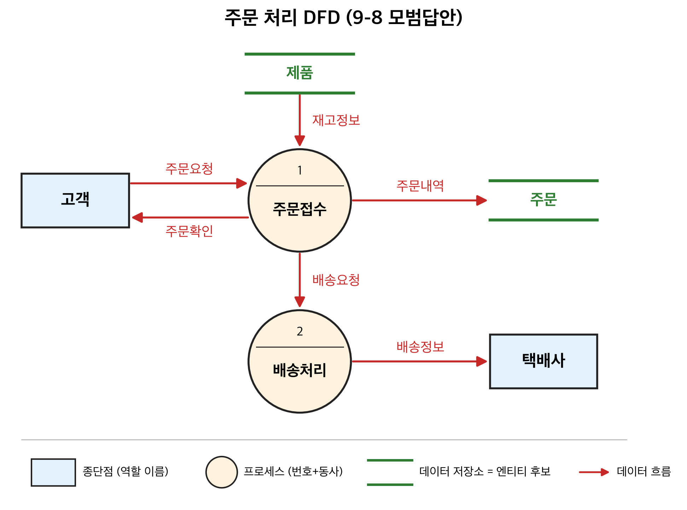
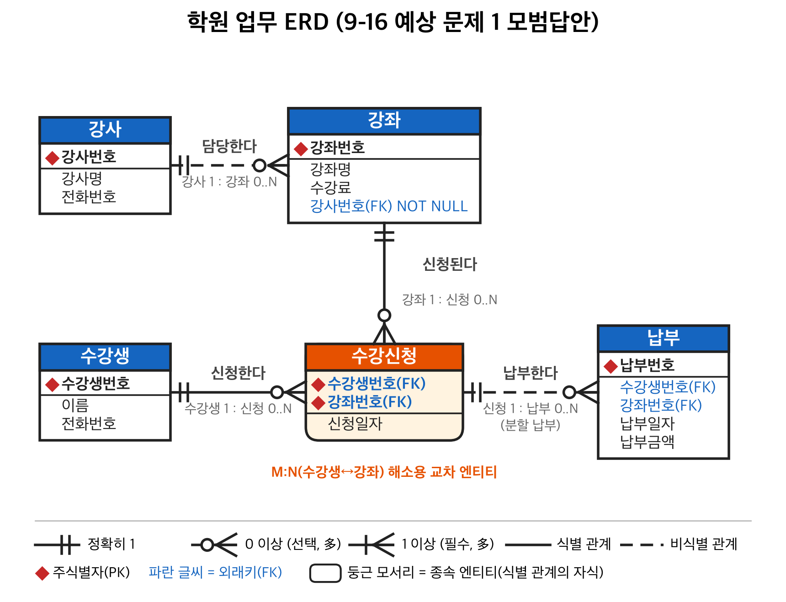
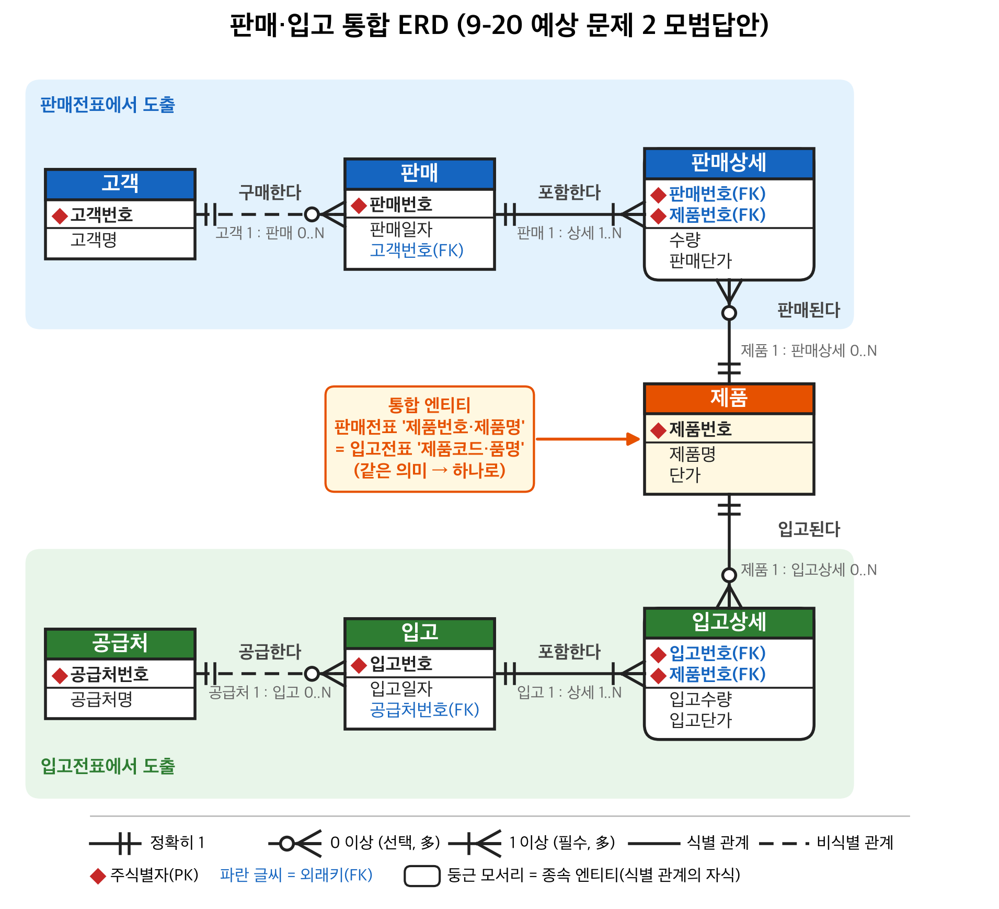

# 데이터베이스응용 중간고사 정리 (1~7장)

> 10/22(목) 12:00~13:00 · 정보과학관 301호 · 주관식 20문항(4~10점) · **ERD 직접 그리기 비중 큼**
> 🖍 <mark>형광펜</mark> = 시험 공지 출제 포인트 (최우선 암기)
> 근거: 강의 슬라이드 1~7장. `[슬라이드 외]` 표시는 슬라이드에 직접 없는 내용이라 서술형 답안용으로 보충한 것.

---

## 0. 전체 흐름 (매 장 첫 슬라이드 그림)

```
업무분석(5) → [논리적 DB설계 = 데이터 모델링]
              엔티티 정의(6) → 식별자/관계 정의(7: 주식별자→관계→외래식별자→업무규칙)
              → 상세화(7: 세부속성) → 정규화(8) → 도메인/용어사전(9) → 통합·검증(10)
          → 물리적 DB설계(11) → DB 구축(12)
```

---

## 1. 장별 핵심

### 1장 DB 개요
- **파일시스템의 문제 6가지**: 데이터 종속성, 무결성 침해, 중복성, 불일치, 표준화 어려움, 보안성 결여
- **DB의 장점**: 데이터 독립성, 무결성 유지, 중복·불일치 최소화, 표준화 용이, 높은 보안성, 공유 용이
- DB = 데이터의 집합 / DBMS = 이를 관리하는 S/W. 응용프로그램은 반드시 DBMS를 통해 접근

### 2장 정보시스템 구축과 DB 설계
- 모델 = 현실세계를 개념화·단순화하여 가시적으로 표현한 것 / 모델링 = 모델 만드는 과정 = 추상화
- DB에는 **개체(entity)의 정보**가 반영, **행위·사건(behavior/event)은 프로그램**에 반영 → 둘이 합쳐져야 현실세계가 온전히 모델링됨
- 구축 절차: ISP → 업무분석 → 데이터모델링 / 프로세스모델링 → **상관모델링(CRUD 매트릭스)** → 물리 DB설계 → DB구축 → 개발·테스트 → 튜닝 → 유지보수

| 구분 | 논리적 DB 설계 | 물리적 DB 설계 |
|---|---|---|
| 정의 | 현실세계 관찰·분석 → 개념적 모델(**ERD**) 작성 = **데이터 모델링** | 논리 설계 기반으로 <mark>테이블·뷰·인덱스 설계, **반정규화** 수행</mark> |
| DBMS | <mark>**DBMS 종류와 무관**</mark> | <mark>**특정 DBMS를 염두**</mark> |
| 용어 | 엔티티, 속성, 주식별자, 외래식별자, 보조식별자 | 테이블, 컬럼, 기본키, 외래키, 대체키 |

**O/X 연습**
- 논리적 설계는 Oracle/MySQL 등 제품을 먼저 정하고 진행한다 → **X**
- 반정규화는 물리적 설계에서 수행한다 → **O**
- 인덱스 설계는 논리적 설계 단계의 작업이다 → **X** (물리)
- 데이터 모델링의 최종 산출물은 ERD이다 → **O**
- 개체의 행위·사건도 DB 설계에 반영된다 → **X** (프로그램에 반영)
- 주식별자는 null 불가, 외래식별자는 null 가능 → **O**
- 1:1 관계의 두 엔티티는 하나로 합칠 수 있다 → **O**
- M:N 관계는 완성된 관계이다 → **X** (해소 작업 필요)

### 3장 모델링 주요 개념
- **엔티티**: 업무의 관심 대상이 되는 정보를 가진 유형·무형의 사물
  - 분류: **유형**(고객, 사원) / **무형**(생산계획, 부서조직) / **문서**(주문서, 거래명세서) / **이력**(입고이력) / **코드**(국가코드)
  - 조건: <mark>① 업무에 필요하고 관리할 정보 ② **인스턴스 2개 이상** ③ **속성 1개 이상**</mark> (속성이 안 보이면 다른 엔티티의 속성일 가능성 — 예: '이름')
  - 명명: 현업 용어, 약어 지양, **단수 명사**, 유일, 생성 의미대로
  - **속성**: 더 이상 분리되지 않는 최소 단위 데이터 → 테이블 컬럼
  - **기본속성**(현실에서 얻음) / **설계속성**(코드, 일련번호) / **유도속성**(금액=수량×단가)
- **관계**: 두 엔티티 간 의미 있는 연결 = **공유하는 속성이 있다**는 뜻 (이름은 달라도 됨)
  - <mark>**카디널리티**(최대 참여수)</mark>: 단일 `|`, 다중 `<`
  - <mark>**참여도**(최소 참여수)</mark>: 필수 `|`, 선택 `O`
  - 대부분 1:N / 1:1은 합칠 수 있음 / M:N은 미완성 → 해소 필요
- **부모-자식**: <mark>정보가 **먼저 생성되는 쪽 = 부모**</mark>, 가져다 쓰는 쪽 = 자식. 일반적으로 **1:N, 부모 쪽 필수 : 자식 쪽 선택**
- 부모의 주식별자 → 자식의 외래식별자

### 4장 ERwin
- CASE 도구: 분석·설계·구현·테스트 전 과정 + 문서화 지원. 데이터설계도구 기능: 논리 모델링, 물리 모델링, DB 자동 구축, **역공학**
- **ERD 4가지 레벨**: <mark>① **엔티티(Entity)** 레벨 ② **주식별자(Primary Key)** 레벨 ③ **식별자(Keys)** 레벨 ④ **속성(Attribute)** 레벨</mark>
- 관계 종류

| 종류 | 의미 | 선 |
|---|---|---|
| **Identifying** (식별 관계) | <mark>FK가 자식 **PK의 일부**</mark> | <mark>**실선**</mark> |
| **Non-Identifying** (비식별 관계) | <mark>FK가 PK와 **별도**(일반 속성)</mark> | <mark>**점선**</mark> |
| M:N | FK 추가 안 됨, 정보만 표시 | — |

- 관계 맺을 때 **부모 먼저 클릭 → 자식 클릭**. 부모 PK가 자식 FK로 자동 추가
- ERwin에서는 부모 쪽 참여도가 '선택'으로 표시되고 수정 불가 (교재와 차이)
- ERwin 기호: `>` many, `|` one, `O` zero. "zero, one, or more" / "one or more"(P) / "zero or one"(Z)
- 업무규칙은 관계선 → **RI Actions** 탭에서 Parent/Child × Insert/Update/Delete Rule 지정

### 5장 업무분석
- 분석 단계의 작은 오류가 누적 → **눈덩이 효과**
- 준비: 회사 이해 → **서브젝트 에어리어** 분할 → 문서 수집 → 담당자 인터뷰 → 정리
- 수집 문서: **업무매뉴얼** / 다른 업무주체와 주고받는 문서(거래명세서) / 고유업무 문서(입고전표 — 담당자에게 직접 받아야 함)
- **인터뷰 필요성**: 문서만으로 불충분, 불명확한 점 해소, 중요/비중요 정보 분리, 현재 문제점은 실무자가 가장 잘 앎
- **인터뷰 계획**: 목표 명확화 / 업무 숙지(용어) / 대상 선정<mark>(데이터·업무 → **일선 담당자**, 의사결정·경영 → **중간관리자**)</mark> / 사전 질문 공지 / **1시간 이내**, 여유 시간대 / 질문 문서화 / 역할 분담
- **질문 유형**

| 유형 | 설명 | 예 |
|---|---|---|
| <mark>열린 질문</mark> | 자유롭게 답하게 함. 의도와 다른 방향으로 흐를 위험 | "가장 큰 애로사항은?" |
| <mark>닫힌 질문</mark> | 정해진 보기 중 선택 | "재고관리가 안 되는 이유는 위치추적/공간부족/수작업 중 무엇?" |
| <mark>추가 질문</mark> | 답변에 대한 보충 질문. 이해하고 있음을 전달 | "예를 하나 들어주시겠습니까?" |

- 주의: 대상자는 소극적 → **주도적 진행**(잡담·하소연 방지), 편안한 분위기, 민감한 사안 신중
- **DFD 표기법** (외워서 그릴 수 있어야 함)

| 기호 | 이름 | 설명 |
|---|---|---|
| `═══` 위아래 두 줄 | <mark>**데이터 저장소**(data store)</mark> | 머물러 있는 자료 집합 → **엔티티 후보** |
| ○ 원/타원 | <mark>**프로세스**(process)</mark> | 입력 흐름 → 출력 흐름으로 변환 |
| → 화살표 | <mark>**데이터 흐름**(data flow)</mark> | 이동 통로·방향. 화살표 위에 데이터 이름 |
| □ 사각형 | <mark>**종단점**(terminator)</mark> | 발생지(source)/도착지(sink). 개인보다 **역할**로 명명 |

예) 도서 대여 예약 DFD
```
 ═도서정보═         [고객]          ═대여정보═
      \ 재고정보     | 예약요청      / 반납예정정보
       └──────→ ( 1.가능일자 확인 ) ←┘
                       | 예약가능정보
                       ↓
                  ( 2.예약생성 )
                       | 예약사항
                       ↓
                   ═예약정보═
```

### 6장 엔티티 정의
- 데이터 모델링의 핵심 = **엔티티 도출**. 정해진 공식은 없음
- 도출 소스: 업무기술서, 인터뷰, 장부·전표, 기존 시스템 산출물, **DFD의 Data Store**, 현장 견학
- **일반적인 도출 순서 (7단계)**
  1. **엔티티 후보 풀**과 **엔티티 리스트**(엔티티명/포함속성/유사어) 준비
  2. 문서에서 **명사** 표시
  3. 명사 분류: 엔티티 → 엔티티명 / 속성 → 포함속성 / 인스턴스 → 소속 엔티티 / **불분명 → 후보 풀**
  4. 중복·유사 명사 통합 (고객, 회원 → 회원; 이용자·회원정보 → 유사어)
  5. 후보 풀 재검토 → 리스트로 옮기거나 제외
  6. 시스템에서 **관리할 필요가 있는지** 검토 (예: 회원카드·회원증·월말결산 제외)
  7. **엔티티 기술서** 작성 (엔티티명 / 설명 / 관련속성 / 유사어 / 비고)
- **후보 구분 기준**: <mark>속성 1개 이상? 인스턴스 2개 이상? 업무상 관리 필요? 속성을 못 찾으면 → 다른 엔티티의 속성</mark>
- **장부/전표에서 도출**: ① DB 저장 필요한가(신규도서 카탈로그 ✗, 회원명단 ○) ② 장표명 대신 엔티티다운 이름(입고전표→입고내역) ③ <mark>**다른 전표에도 반복 등장하는 항목**을 별도 엔티티로 추출</mark>(업체→공급처, 제품→제품정보) ④ 기술서 작성

#### ★ 헤더/상세(Header/Detail)를 구분해야 하는 이유
판매전표 한 장 = 헤더(판매번호·일자·부서·사원·고객) 1건 + 상세(제품·수량·단가) **여러 건**.
- <mark>하나의 엔티티로 두면 **반복 그룹** 발생 → 품목 수만큼 헤더 정보(일자·고객 등)가 **중복 저장**되고, 수정 시 **불일치**·삽입/삭제 이상 발생</mark>
- <mark>몇 개 품목이 올지 몰라 컬럼 수를 정할 수 없음</mark> (제품1, 제품2, …)
- 헤더 1 : 상세 N 의 관계를 명확히 하여 상세 품목 단위 집계·조회가 가능해짐

### 7장 식별자·관계·속성 정의
- **주식별자**: 인스턴스를 구분하는 기준 속성. <mark>**현재뿐 아니라 미래에도 중복 없어야** 함</mark>. 확인 방법 = **테이블을 그려본다**
- 복합 주식별자: 일일판매실적(**판매일자+제품번호**)
- 마땅한 주식별자 없음: 수입제품(제품번호+제조업체+원산지) **또는** 인위적 주식별자 `일련번호`
- **인위적 주식별자의 문제점**: 같은 전표를 실수로 두 번 입력해도 대출번호만 다르면 들어감 → <mark>**내용상 중복** 발생</mark> (대출일+회원번호+도서관리번호로 잡았다면 막힘)
- ★ <mark>**최소성**: 주식별자는 **최소한의 속성**으로 구성.</mark> 판매일자 하나만 PK면 같은 날 다른 제품을 넣을 수 없음(유일성 부족), 반대로 불필요한 속성이 포함되면 중복을 못 막음/낭비
  - <mark>검토법: PK의 속성을 하나씩 빼봤을 때도 유일성이 유지되면 그 속성은 불필요 → 제거</mark>

- **관계 정의 방법**: ① 문서에서 **동사** 찾기(고객에게 주문서를 **발송**) ② **관계 매트릭스** ③ <mark>부모·자식 찾기(A를 만들려면 B 정보가 필요 → B가 부모)</mark> ④ 카디널리티·참여도 표시
- **외래식별자 정의**: 부모/자식 구분 → 부모 PK가 자식에 있는지 확인, 없으면 추가
- **Rule 1~4**: ① 관계 있음 = 공유 속성 있음 ② 먼저 생성되는 쪽이 부모 <mark>③ 부모의 공통속성은 PK, 자식의 공통속성은 FK ④ 부모:자식 = 1:N (1쪽이 부모)</mark>

---

## 2. ★ 참조무결성 (업무규칙)

<mark>**업무규칙** = 관계 있는 두 테이블에서 한쪽 데이터 변화로 생길 **불일치를 막기 위한 조치**를 정의한 것</mark>

예시 데이터: 부서(101 영업부, 125 관리부, 146 생산1부, 150 생산2부), 사원(김철수 101, 홍길동 101, 강만길 125, 이재천 146)

### 부모 테이블 삭제/수정 규칙
| 규칙 | 삭제(delete) | 수정(update) |
|---|---|---|
| **Restrict** | <mark>자식이 참조 중이면 **삭제 불가**</mark> (101,125,146 불가 / 150 가능) | 참조 중이면 **수정 불가** |
| **Cascade** | <mark>자식도 **함께 삭제**</mark> (101 삭제 → 김철수·홍길동 삭제) | 자식 FK도 **함께 수정** (101→111이면 사원 부서도 111) |
| **Set Null** | <mark>자식 FK를 **null**로</mark> (김철수·홍길동 부서 = null) | 자식 FK를 null로 |
| Set Default | 자식 FK를 미리 정한 기본값으로 | 동일 |
| None | 아무 조치 없음 (무결성 깨질 수 있음) | 동일 |

### 자식 테이블 삽입/수정 규칙
| 규칙 | 의미 |
|---|---|
| **Restrict** | <mark>부모에 없는 값(777)이면 삽입/수정 **거부 + 에러**</mark> |
| None | 어떤 값이든 허용 |

> <mark>**자식 튜플 삭제는 부모에 아무 영향 없음**</mark>

### 3가지 정책 비교 (서술형 답안용)
| | Restrict | Cascade | Set Null |
|---|---|---|---|
| 무결성 보장 방식 | <mark>위반 연산 자체를 **거부**</mark> | <mark>변경을 자식에 **전파**</mark> | <mark>참조를 **끊음**</mark> |
| 장점 | 가장 안전, 실수로 인한 데이터 손실 방지 | 일관성 자동 유지, 편리 | 자식 데이터는 보존 |
| 단점 | 부모 삭제 전 자식을 먼저 정리해야 해서 번거로움 | <mark>**의도치 않은 대량 삭제** 위험</mark> | <mark>FK가 **NOT NULL이면 사용 불가**</mark>, 소속 불명 데이터 생김 |
| 적합한 업무 예 | 대출 기록이 있는 회원은 탈퇴 불가 | 주문 삭제 시 주문상세도 삭제 (헤더-상세) | 부서 폐지 시 사원은 남기고 부서만 미정 |

**업무규칙 결정 예** (도서관, 슬라이드의 ERwin RI Actions)
- 회원 → 대출: Parent Delete = **Set Null** 또는 Restrict / Parent Update = **Cascade** / Child Insert·Update = **Restrict** / Child Delete = None
- <mark>판단 질문: "부모가 사라질 때 자식 기록을 보존해야 하는가?" → 보존 필요(이력·회계) → Restrict/Set Null, 종속 데이터 → Cascade</mark>

### 데이터 변경 시 적절한 처리 방법 `[슬라이드 외 보충]`
- 부모 PK 변경: PK는 원칙적으로 바뀌지 않는 값으로 선정 → 그래도 바뀌면 **Cascade update**
- 부모 삭제: 이력 보존 필요 → **Restrict**(또는 탈퇴여부 같은 **논리 삭제** 플래그 — 도서관 사례의 '탈퇴여부' 속성) / 종속 데이터 → Cascade
- <mark>자식 삽입·FK 수정: 항상 **Restrict** (존재하지 않는 부모 참조 금지)</mark>

---

## 3. ★ 유도속성

- 정의: 다른 속성으로부터 계산·변형되어 나오는 속성 (금액 = 수량 × 단가, 평균 = 합계/인원수, 합계금액, 누적구매금액, 총인원)
- **불일치 문제** (그림 7.33): MP3 단가가 350 → 360으로 바뀌었는데 금액 3500을 수정하지 않음 → 수량×단가(3600) ≠ 금액(3500)
  - <mark>원본 속성이 바뀔 때 유도속성을 **함께 갱신하지 않으면** 불일치</mark>
  - 같은 정보가 두 군데 저장 = **중복** → 갱신 누락, 동시성 문제

**저장 여부 판단 기준** `[슬라이드 외 보충]`
| 저장하는 게 유리 | 저장하지 않는 게 유리 |
|---|---|
| <mark>계산 비용이 크고 **조회가 매우 잦음**</mark> (예: 누적구매금액을 매번 전체 합산) | 계산이 간단함 (수량×단가) |
| <mark>원본 데이터가 **거의 변경되지 않음**</mark> | 원본이 **자주 변경**됨 |
| <mark>당시 값을 **이력으로 보존**해야 함</mark> (판매 당시 금액, 이후 단가가 바뀌어도 유지) | 항상 최신 값이 필요 |
| <mark>저장한다면: 트리거/프로그램으로 **동기화 방안**을 반드시 마련</mark> | |

> 판매상세의 `단가`는 제품 엔티티의 현재 단가가 아니라 **판매 당시 단가**라서 저장 의미가 있음(이력). `금액`은 판매상세의 수량×단가로 계산 가능 → 유도속성.

---

## 4. ★ 외래키 위치와 Null 여부

1. <mark>**FK는 항상 N쪽(자식)에 둔다**</mark> — 1쪽 부모의 PK가 N쪽으로 내려감
2. 1:1이면 나중에 생성되는/선택 참여하는 쪽에 둔다
3. <mark>M:N이면 **교차(연관) 엔티티**를 만들어 양쪽 PK를 모두 FK로 받음</mark>
4. <mark>**Null 여부** = 자식이 **부모 관계에 필수 참여인가?**</mark>
   - 자식이 반드시 부모를 가짐(사원은 반드시 부서 소속) → FK **NOT NULL**
   - 자식이 부모 없이 존재 가능(사원이 부서 미배정 가능) → FK **NULL 허용**
   - <mark>**식별 관계**(FK가 PK의 일부) → PK이므로 **무조건 NOT NULL**</mark>
   - Set Null 규칙을 쓰려면 FK가 NULL 허용이어야 함

---

## 5. ★ 양쪽 최소·최대 참여수 표기

<mark>`(최소, 최대)` = (참여도, 카디널리티). **상대 엔티티 인스턴스 1개 기준**</mark>으로 "나와 연결되는 개수"

예) "모든 사원은 반드시 하나의 부서에 소속된다. 부서는 사원이 없을 수도, 여러 명일 수도 있다."
```
 부서 ||──────────────────O< 사원
     (1,1)               (0,N)
   부서 1개당 사원: (0, N)   → 사원 쪽 끝에  O<   (선택, 다수)
   사원 1명당 부서: (1, 1)   → 부서 쪽 끝에  ||   (필수, 단일)
```
- <mark>기호는 **상대방 쪽 끝**에 그린다. 안쪽 기호 = 최소(O 선택 / | 필수), 바깥쪽 = 최대(| 단일 / < 다수)</mark>
- 사원 쪽 FK `부서코드` → 사원이 부서에 필수 참여 → **NOT NULL**

ERD 시험 답안 체크리스트
- [ ] 엔티티명(단수 명사) / PK 위쪽 구획, 일반 속성 아래
- [ ] FK에 `(FK)` 표시, N쪽에 위치
- [ ] 관계선 양 끝에 최소·최대 기호
- [ ] 관계명(양방향 동사: 소속된다/포함한다)
- [ ] 식별(실선)/비식별(점선) 구분
- [ ] M:N 해소했는지
- [ ] 유도속성 처리 근거

---

## 6. ★ 서술형 대비: 화면 설계 기반 DB 구축의 문제점 3가지와 개선 절차 `[슬라이드 개념 조합]`

**상황**: 개발자가 화면을 먼저 설계하고 화면 항목을 그대로 테이블 컬럼으로 만든 경우

**문제점**
1. <mark>**데이터 중복 → 불일치**</mark>: 여러 화면에 같은 항목(고객명·주소 등)이 반복 → 테이블마다 중복 저장, 한 곳만 수정되면 불일치 (1장 파일시스템 문제와 동일)
2. <mark>**엔티티·관계·식별자 미정의**</mark>: 화면 단위(=장표 단위) 테이블이라 헤더/상세가 섞여 반복 그룹 발생, 주식별자·외래키·참조무결성 규칙이 없음 → 무결성 깨짐
3. <mark>**유도속성·화면 전용 항목의 무분별한 저장**</mark>: 합계·금액 등 계산값을 저장해 불일치 발생, 업무 변경/화면 변경 시 DB 구조가 따라 바뀌어야 함(화면에 종속, 확장성·유지보수성 저하, 표준화 어려움)

**개선 절차** (DB 설계 과정 순서대로)
1. **업무분석**: 문서·장표 수집, 담당자 인터뷰, DFD 작성 <mark>(화면이 아니라 **업무와 데이터** 기준)</mark>
2. **엔티티 도출**: 명사 추출 → 후보풀/리스트 → 중복 통합 → 필요성 검토 → 엔티티 기술서. 반복 항목은 별도 엔티티, 헤더/상세 분리
3. **주식별자 정의**: 유일성·최소성 검토
4. **관계·외래식별자 정의**: 부모/자식, 카디널리티·참여도, FK 위치·NULL 여부
5. **업무규칙(참조무결성) 정의**: Restrict/Cascade/Set Null
6. **속성 상세화**: 기본/설계(코드화)/유도속성 저장 여부 결정 → 정규화 → 통합·검증 → 물리 설계

---

## 7. 연습: ERD 그리기

### 문제 A — 판매전표 (6장 예제) → 통합 ERD
전표 항목: 판매번호, 판매일자, 판매부서·부서명·당월실적누계, 판매사원번호·사원명, 고객번호·고객명·고객주소·누적구매금액, [제품번호·제품명·단가·수량·금액]×N, 합계금액

**엔티티 도출**: 부서, 사원, 고객, 제품, 판매(헤더), 판매상세(상세)

```
 [부서]                [사원]                 [고객]
 ◆부서코드              ◆사원번호               ◆고객번호
 부서명                 사원명                  고객명
 당월실적누계(유도)      부서코드(FK)            고객주소
                                              누적구매금액(유도)
   |1                     |1                     |1
   |                      |                      |
   O<N                    O<N                    O<N
 [판매] ◆판매번호  판매일자  부서코드(FK)  사원번호(FK)  고객번호(FK)  (합계금액: 유도)
   ||1
   |   식별 관계(실선)
   |<N
 [판매상세] ◆판매번호(FK)  ◆제품번호(FK)  수량  판매단가  (금액: 유도)
   >O
   |N
   ||1
 [제품] ◆제품번호  제품명  단가
```

- <mark>판매상세 PK = **판매번호+제품번호** (복합, 식별 관계)</mark>. 같은 전표에 같은 제품이 두 줄 나올 수 있으면 `순번`을 추가
- 판매–판매상세: 판매 1건당 상세 (1,N), 상세 1건당 판매 (1,1)
- 판매상세–제품: 제품 1개당 상세 (0,N) — 한 번도 안 팔린 제품 가능
- 사원–부서 관계도 추가 가능(사원.부서코드 FK). 판매부서가 항상 사원의 소속부서면 판매.부서코드는 **사원을 통해 유도되므로 중복** → 제거 검토
- 유도속성: 금액, 합계금액, 당월실적누계, 누적구매금액 → 저장 여부는 §3 기준으로 판단

### 문제 B — 도서관 (5~7장 사례)
```
 [회원] ◆회원번호 회원이름 전화번호 집주소 이메일 탈퇴여부 우수회원여부 미반납여부 가입일자
    ||                                        
    |  회원은 대출을 0~N회
    O<
 [대출] ◆대출번호  회원번호(FK)  도서관리번호(FK)  대출일  반납예정일  반납여부  반납구분  연체료납부여부
    >O
    |  도서는 0~N번 대출됨
    ||
 [도서] ◆도서관리번호 분류기호 제목 저자 출판사 출판연도 구입일자 국내/해외구분 신간도서여부 세금계산서번호(FK)
    >O
    ||
 [세금계산서] ◆접수번호
```
- <mark>회원–도서는 원래 **M:N** → `대출`이 교차 엔티티로 해소</mark>
- 대출의 FK는 비식별 관계(인위적 PK 대출번호) → 대출은 반드시 회원·도서가 있어야 하므로 FK **NOT NULL**
- 인위적 PK의 위험: 같은 대출 전표 중복 입력 가능 → 대안 PK (대출일+회원번호+도서관리번호)
- 업무규칙: "미반납 도서가 있으면 탈퇴 불가" → 회원 삭제 **Restrict** 또는 탈퇴여부로 논리 삭제

### 문제 C — 잘못 설계된 엔티티 재설계 (스스로 풀어보기)
```
 수강신청( 학번, 이름, 전공, 과목1, 과목2, 과목3, 과목명1, 과목명2, 과목명3 )
```
문제점: <mark>반복 그룹(과목1~3), 학생 정보 중복, 과목명 중복·불일치, PK 불명확, 과목이 4개면 구조 변경 필요</mark>
→ 재설계: 학생(◆학번, 이름, 전공) / 과목(◆과목번호, 과목명, 학점) / 수강(◆학번(FK), ◆과목번호(FK), ◆학기) — 학생 1:N 수강 N:1 과목, 식별 관계

### 문제 D — 관계 분석 후 오류 찾기 체크 포인트
- FK가 1쪽(부모)에 들어가 있지 않은가?
- M:N 관계가 해소되지 않은 채 남아 있지 않은가?
- 1:1인데 합칠 수 있지 않은가?
- 참여도가 업무 규칙과 맞는가? (필수인데 FK가 NULL 허용 등)
- PK가 최소성을 만족하는가 / 미래에도 유일한가?
- 관계가 있는데 공유 속성(FK)이 빠져 있지 않은가?
- 다른 관계를 통해 유도 가능한 중복 관계/FK는 없는가?

---

## 8. 단답 암기 리스트
- ERwin 4레벨: **엔티티 / 주식별자 / 식별자(Keys) / 속성**
- DFD 4기호: **데이터 저장소 / 프로세스 / 데이터 흐름 / 종단점**
- 인터뷰 질문 3유형: **열린 / 닫힌 / 추가**
- 엔티티 5분류: **유형 / 무형 / 문서 / 이력 / 코드**
- 속성 3분류: **기본 / 설계 / 유도**
- 데이터 모델링 3요소: **엔티티 / 관계 / 속성**
- 식별자 ↔ 키: 주식별자-기본키, 외래식별자-외래키, 보조식별자-대체키
- 삭제·수정 규칙: **Restrict / Cascade / Set Null** (+ Set Default, None)
- 식별 관계 = 실선 = FK가 PK 일부 / 비식별 관계 = 점선
- 파일시스템 문제 6: 종속성, 무결성 침해, 중복성, 불일치, 표준화 어려움, 보안 결여

---

## 9. 🎯 시험 예시별 모범답안 + 공부할 내용

> 공지에 나온 예시 문제 유형마다 **[예상 문제] → [모범답안] → [공부할 것]** 순서로 정리. `[슬라이드 외]` = 슬라이드에 직접 없는 보충.

### 9-1. 화면 설계 후 화면 항목으로 DB를 구축할 때의 문제점 3가지와 개선 절차
**[예상 문제]** 시스템 개발자가 화면을 먼저 설계하고 화면 항목을 그대로 테이블로 만들었다. 문제점 3가지와 개선 절차를 서술하시오.

**[모범답안]**
> 문제점 ① <mark>**데이터 중복과 불일치**</mark>: 여러 화면에 나오는 같은 항목(고객명·주소 등)이 테이블마다 중복 저장되어, 한 곳만 수정하면 데이터가 서로 달라진다.
> ② <mark>**엔티티·식별자·관계가 정의되지 않음**</mark>: 화면 단위로 테이블을 만들어 헤더와 상세가 섞이고 반복 그룹이 생기며, 주식별자·외래키·참조무결성 규칙이 없어 무결성이 깨진다.
> ③ <mark>**화면에 종속된 구조**</mark>: 합계·금액 같은 유도속성이나 화면 전용 항목까지 저장해 불일치가 생기고, 화면이 바뀌면 DB 구조도 바꿔야 해서 확장성과 유지보수성이 떨어진다.
>
> 개선 절차: <mark>업무분석(문서 수집·인터뷰·DFD) → 엔티티 도출(명사 추출, 헤더/상세 분리) → 주식별자 정의(유일성·최소성) → 관계·외래식별자 정의(카디널리티·참여도, FK 위치·NULL) → 업무규칙(참조무결성) 정의 → 속성 상세화(유도속성 판단) → 물리 설계</mark>. 즉 **화면이 아니라 업무와 데이터를 기준으로** 설계해야 한다.

**[공부할 것]** §6 전체, 1장 파일시스템 문제 6가지(중복성·불일치·종속성과 연결해서 쓰면 가산점), 2장 DB 구축 절차.

---

### 9-2. 논리적 / 물리적 모델링 O·X
**[예상 문제 + 정답]**
| # | 문장 | 답 | 이유 |
|---|---|---|---|
| 1 | 논리적 설계는 사용할 DBMS 제품을 먼저 정하고 진행한다 | **X** | 논리 = DBMS와 무관 |
| 2 | 물리적 설계에서는 테이블·컬럼·기본키·외래키 용어를 쓴다 | **O** | 논리는 엔티티·속성·주식별자·외래식별자 |
| 3 | 엔티티, 속성, 주식별자는 물리적 모델링 용어다 | **X** | 논리 용어 |
| 4 | 반정규화는 물리적 설계에서 수행한다 | **O** | 성능을 위해 특정 DBMS 고려 |
| 5 | 인덱스·뷰 설계는 논리적 설계 작업이다 | **X** | 물리 |
| 6 | 데이터 모델링(논리적 설계)의 결과물은 ERD이다 | **O** | |
| 7 | 정규화는 논리적 설계 과정에 포함된다 | **O** | 전체 흐름도: 정규화(8)는 논리 설계 안 |
| 8 | 보조식별자는 물리 단계에서 대체키가 된다 | **O** | 주식별자→기본키, 외래식별자→외래키 |
| 9 | 개체의 행위·사건도 DB에 저장되도록 설계한다 | **X** | 행위·사건은 프로그램에 반영 |
| 10 | ERwin은 논리·물리 모델링과 역공학을 모두 지원한다 | **O** | |

**[공부할 것]** 2장 논리 vs 물리 비교표의 <mark>정의 / DBMS 종속 여부 / 용어</mark> 3줄을 통째로 암기.

---

### 9-3. 조건(업무기술서)에 따른 엔티티 도출
**[예상 문제]** 다음 업무 설명에서 엔티티를 도출하시오.
> "○○학원은 **강사**와 **강좌**를 관리한다. **수강생**은 **학원 홈페이지**에서 **수강신청서**를 작성하여 여러 강좌를 신청할 수 있고, 한 강좌에는 여러 수강생이 신청한다. 각 강좌는 한 명의 강사가 담당한다. 수강생은 신청한 강좌의 **수강료**를 나누어 **납부**할 수 있으며 **납부일자**와 **납부금액**을 기록한다. 우수 수강생 **홍길동**에게는 장학금을 준다."

**[모범답안]**
| 명사 | 판정 | 이유 |
|---|---|---|
| 강사, 강좌, 수강생 | **엔티티** | 업무상 관리 필요, 인스턴스 여러 개, 속성 있음 |
| 수강신청서 | **엔티티 → '수강신청'**으로 이름 변경 | 장표명 대신 엔티티다운 이름. 수강생–강좌 **M:N을 해소하는 교차 엔티티** |
| 납부 | **엔티티** | 한 신청에 여러 번 납부 → 별도 엔티티 |
| 수강료 | 강좌의 **속성** | |
| 납부일자, 납부금액 | 납부의 **속성** | |
| 홍길동 | **인스턴스** (수강생 소속) | |
| ○○학원 | **제외** | 인스턴스가 1개뿐 |
| 학원 홈페이지 | **제외** | 시스템에서 관리할 데이터가 아님 |

→ 최종 엔티티: <mark>강사, 강좌, 수강생, 수강신청, 납부</mark> (ERD는 9-16 참고)

**[공부할 것]** 6장 7단계(명사 표시 → 분류 → 통합 → 필요성 검토 → 기술서), 3장 엔티티 조건 3가지.

---

### 9-4. 엔티티 간 양쪽 최소·최대 참여수 표기
**[예상 문제]** 조건을 보고 관계선 양 끝 기호와 (최소, 최대)를 쓰시오.

**[모범답안]**
- (a) "고객은 주문을 안 할 수도, 여러 번 할 수도 있다. 주문은 반드시 한 고객이 한다."
  - 고객 1명당 주문: **(0, N)** → 주문 쪽 끝 `O<`
  - 주문 1건당 고객: **(1, 1)** → 고객 쪽 끝 `||`
  - `고객 ||──────O< 주문`
- (b) "사원은 주차카드를 최대 1장 받을 수 있다(안 받아도 됨). 주차카드는 반드시 한 사원에게 발급된다."
  - 사원 1명당 카드: **(0, 1)** → 카드 쪽 끝 `O|`
  - 카드 1장당 사원: **(1, 1)** → 사원 쪽 끝 `||`
  - `사원 ||──────O| 주차카드` (1:1)
- (c) "주문 1건에는 제품이 최소 1개 이상 들어간다. 제품은 주문된 적이 없을 수도 있다." → M:N → 주문상세로 해소
  - `주문 ||──────|< 주문상세 >O──────|| 제품`
  - 주문 1건당 주문상세 **(1, N)**, 제품 1개당 주문상세 **(0, N)**, 주문상세 1건당 주문·제품 각각 **(1, 1)**

<mark>읽는 법: "상대 엔티티 1개 기준으로 나와 연결되는 개수" → 그 기호는 **나(=세어지는 쪽) 끝**에 그린다. 안쪽 = 최소(O/|), 바깥쪽 = 최대(|/<)</mark>

**[공부할 것]** §5, 3장 카디널리티·참여도 정의, 4장 ERwin 기호(P = one or more, Z = zero or one).

---

### 9-5. 외래키 위치와 Null 여부
**[예상 문제]** 9-4의 (a)~(c)에서 FK는 어디에, NULL 허용 여부는?

**[모범답안]**
| 관계 | FK 위치 | NULL 여부 | 근거 |
|---|---|---|---|
| (a) 고객–주문 | 주문.고객번호 | **NOT NULL** | 1:N → N쪽(자식). 주문은 반드시 고객이 있음(필수 참여) |
| (b) 사원–주차카드 | 주차카드.사원번호 | **NOT NULL** | 1:1 → 나중에 생기고 선택 참여하는 쪽(카드)에. 카드는 반드시 사원 있음 |
| (c) 주문–주문상세–제품 | 주문상세.주문번호, 주문상세.제품번호 | **NOT NULL** | 식별 관계 → FK가 PK의 일부 → 무조건 NOT NULL |
| 예) 사원–부서 (부서 미배정 허용) | 사원.부서코드 | **NULL 허용** | 자식이 부모 없이 존재 가능(선택 참여) |

> <mark>NULL 판단 한 줄: **자식 쪽에서 부모 쪽으로의 최소 참여수가 1이면 NOT NULL, 0이면 NULL 허용.** 식별 관계면 무조건 NOT NULL. Set Null 규칙을 쓰려면 NULL 허용이어야 함.</mark>

**[공부할 것]** §4, 7장 Rule 1~4.

---

### 9-6. ERwin의 ERD 4가지 레벨
**[모범답안]** (슬라이드 4.4 "ERD를 레벨별로 보기")
| 레벨 | 보이는 것 |
|---|---|
| <mark>① 엔티티(Entity) 레벨</mark> | 엔티티 **이름**과 관계선만 (전체 구조 파악용) |
| <mark>② 속성(Attribute) 레벨</mark> | PK·FK·일반 속성 **전부** (가장 상세, 기본 화면) |
| <mark>③ 주식별자(Primary Key) 레벨</mark> | 엔티티명 + **주식별자만** |
| <mark>④ 식별자(Keys) 레벨</mark> | 주식별자 + **외래식별자 등 키 속성만** |

**[공부할 것]** 4레벨 이름 + 각각 보이는 내용, 식별(실선)/비식별(점선) 관계, 관계 맺는 순서(부모 먼저 → 자식), RI Actions 탭.

---

### 9-7. 인터뷰 중 질의(질문) 고민
**[예상 문제]** 도서관 대출 담당자와 인터뷰하려 한다. 열린·닫힌·추가 질문을 하나씩 작성하고, 인터뷰 시 주의점을 쓰시오.

**[모범답안]**
- <mark>**열린 질문**</mark>: "현재 대출 업무에서 가장 불편한 점은 무엇입니까?" → 생각을 자유롭게 말하게 함. 단점: 의도와 다른 방향으로 흐를 수 있음
- <mark>**닫힌 질문**</mark>: "연체가 생기는 주된 이유는 ①반납일 미인지 ②분실 ③장기 출장 중 무엇입니까?" → 정해진 보기 중 선택. 원하는 정보를 빠르게 얻음
- <mark>**추가 질문**</mark>: "방금 '예약 도서가 꼬인다'고 하셨는데, 예를 하나 들어 주시겠습니까?" → 보충 질문. 이해하고 있음을 상대에게 전달
- **주의점/계획**: 목표를 명확히 함, 업무 용어를 미리 숙지, 대상 선정(데이터·실무 = **일선 담당자**, 의사결정 = **중간관리자**), 질문을 **사전에 알리고 문서화**, **1시간 이내**·업무에 지장 없는 시간, 분석자 역할 분담, **주도적으로 진행**(잡담·하소연 방지), 편안한 분위기, 민감한 사안은 신중히

**[공부할 것]** 5장 인터뷰 필요성 4가지, 인터뷰 계획(1)(2), 질문 3유형의 정의·장단점.

---

### 9-8. DFD 약속된 표기법으로 데이터 흐름 작성
**[예상 문제]** "고객이 주문을 요청하면 제품 재고를 확인하여 주문을 접수하고, 주문 내역을 저장한 뒤 고객에게 주문 확인을 보낸다. 접수된 주문은 배송 처리되어 택배사로 전달된다." 를 DFD로 그리시오.

**[모범답안]**
```
           ──────주문요청──────→
 [고객]                           ( 1.주문접수 ) ──────주문내역──────→ ══주문══
           ←─────주문확인───────        ↑      │
                                재고정보 │      │ 배송요청
                                        │      ↓
                                  ══제품══   ( 2.배송처리 ) ──배송정보──→ [택배사]
```


- □ 종단점: 고객, 택배사 (사람 이름이 아니라 **역할**로)
- ○ 프로세스: **번호 + 동사형** 이름 (1.주문접수, 2.배송처리)
- ═ 데이터 저장소: 주문, 제품 → <mark>저장소는 그대로 **엔티티 후보**</mark>
- → 데이터 흐름: <mark>화살표마다 **데이터 이름**을 반드시 적는다</mark>

> `[슬라이드 외]` 일반적인 DFD 규칙: 데이터 흐름은 반드시 **프로세스를 거친다** (종단점→저장소, 저장소→저장소, 종단점→종단점으로 직접 연결 X). 프로세스는 입력과 출력이 모두 있어야 함.

**[공부할 것]** 5장 DFD 4기호와 이름, 도서 대여 예약 DFD 예제를 손으로 다시 그려 보기.

---

### 9-9. 엔티티 후보 · 9-10. 후보 구분 방법
**[예상 문제]** 다음 명사를 엔티티/속성/인스턴스/제외로 구분하시오: 회원, 회원이름, 홍길동, 도서, 대출, 회원카드, 이용자, 월말결산, 국가코드

**[모범답안]**
| 명사 | 구분 | 근거 |
|---|---|---|
| 회원, 도서, 대출 | 엔티티 | 관리 필요 + 인스턴스 2개↑ + 속성 1개↑ |
| 회원이름 | 회원의 속성 | 더 이상 나뉘지 않는 값, 자체 속성이 없음 |
| 홍길동 | 인스턴스 | 회원 엔티티의 한 행 |
| 이용자 | 회원의 **유사어** → 통합 | 중복·유사 명사 통합 |
| 회원카드, 월말결산 | 제외 | 시스템에서 **관리할 필요 없음** |
| 국가코드 | 엔티티(코드 엔티티) | 엔티티 5분류 중 코드 |

<mark>후보 구분 3질문: ① 업무상 **관리할 필요**가 있는가? ② **인스턴스가 2개 이상**인가? ③ **속성이 1개 이상**인가? → 속성을 못 찾으면 다른 엔티티의 속성 / 판단이 애매하면 **후보 풀**에 두고 나중에 재검토</mark>

**[공부할 것]** 6장 도출 7단계, 엔티티 리스트·후보 풀·엔티티 기술서 양식, 3장 엔티티 5분류.

---

### 9-11. 잘못 설계된 엔티티를 재설계
**[예상 문제]** `주문(주문번호, 주문일, 고객번호, 고객명, 고객주소, 제품번호1, 제품명1, 수량1, 제품번호2, 제품명2, 수량2)` 의 문제점과 재설계안은?

**[모범답안]**
- 문제점: <mark>**반복 그룹**(제품1·2…) → 제품이 3개면 구조 변경 필요 / 고객명·주소가 주문마다 **중복** → 불일치 / 제품명 중복 / 헤더와 상세가 한 엔티티에 섞임</mark>
- 재설계:
  - 고객(◆고객번호, 고객명, 고객주소)
  - 제품(◆제품번호, 제품명, 단가)
  - 주문(◆주문번호, 주문일, 고객번호(FK)) — 헤더
  - 주문상세(◆주문번호(FK), ◆제품번호(FK), 수량) — 상세, 식별 관계
  - 관계: 고객 1:N 주문, 주문 1:N 주문상세, 제품 1:N 주문상세

**[재설계 순서]** ① 반복 항목 찾기 → 상세로 분리 ② 다른 엔티티의 정보(고객명·제품명)는 해당 엔티티로 이동, FK만 남김 ③ 각 엔티티 PK 정하기 ④ 관계·참여수·FK 표시
**[공부할 것]** §7 문제 C, 6장 헤더/상세, 장표에서 반복 항목 추출.

---

### 9-12. 독립 엔티티 모델링 `[슬라이드 외 — ERwin/IDEF1X 표기 기준]`
**[모범답안]**
- <mark>**독립 엔티티(Independent)**: 다른 엔티티의 PK를 빌리지 않고 **자기 속성만으로 식별**되는 엔티티. ERwin에서 **각진 사각형**</mark> 예) 부서, 고객, 제품, 회원, 도서
- <mark>**종속 엔티티(Dependent)**: **식별 관계**로 부모 PK를 자신의 PK 일부로 받는 엔티티. ERwin에서 **모서리가 둥근 사각형**</mark> 예) 판매상세(판매번호+제품번호), 수강(학번+과목번호)
- 비식별 관계로 FK만 받는 엔티티(사원 → 부서코드 FK)는 PK가 독립적이므로 **독립 엔티티**
- 모델링 순서: 기준·마스터 정보(고객·제품·부서)를 **독립 엔티티로 먼저** 만들고 → 이를 참조하는 거래 엔티티(주문·판매) → 상세 엔티티(종속) 순으로 붙인다
- 판단: "이 엔티티의 인스턴스를 **부모 없이** 식별할 수 있는가?" 가능 → 독립 / 불가능 → 종속(식별 관계)

**[공부할 것]** 4장 Identifying(실선) vs Non-Identifying(점선). ※ 수업에서 '독립 엔티티'를 다르게 정의했다면 그 정의를 우선할 것.

---

### 9-13. 헤더와 상세를 구분해야 하는 이유
**[모범답안]**
> 전표 한 장은 <mark>**헤더 1건 : 상세 N건**</mark> 구조이다. 이를 한 엔티티로 두면 ① <mark>**반복 그룹**</mark>이 생겨 품목이 몇 개 올지 몰라 컬럼 수를 정할 수 없고, ② 품목 행마다 판매일자·고객 등 헤더 정보가 <mark>**중복 저장**</mark>되어 수정 시 **불일치**가 생기며, ③ **삽입·삭제 이상**(마지막 품목 삭제 시 전표 정보까지 사라짐 등)이 발생한다. 따라서 헤더(판매)와 상세(판매상세)를 분리하고 **1:N 식별 관계**로 연결해야 품목 단위 조회·집계도 정확해진다.

**[공부할 것]** 6장 판매전표 예제, §7 문제 A.

---

### 9-14. 관계 분석 후 오류 분석
**[예상 문제]** 다음 ERD의 오류를 찾고 고치시오.
```
 [부서] ◆부서코드 부서명 사원번호(FK)      ||───O<  [사원] ◆사원번호 사원명
 [학생] ◆학번 이름                         >O───O<  [과목] ◆과목번호 과목명
 [사원] 부서코드(FK, NULL 허용)  ← 업무규칙: 모든 사원은 반드시 부서에 소속
```
**[모범답안]**
| 오류 | 수정 |
|---|---|
| <mark>FK가 1쪽(부모)인 부서에 있음</mark> → 부서 하나에 사원 여러 명을 못 담음 | 부서.사원번호 삭제, **사원.부서코드(FK)** 추가 |
| <mark>학생–과목 **M:N 미해소**</mark> | 교차 엔티티 **수강(◆학번 FK, ◆과목번호 FK, 학기, 성적)** 추가 |
| <mark>필수 참여인데 FK가 **NULL 허용**</mark> | 사원.부서코드 **NOT NULL**, 부서 쪽 기호 `||` |

**오류 체크리스트**: FK 위치 / M:N 미해소 / 합칠 수 있는 1:1 / 참여도와 NULL 불일치 / PK 최소성·미래 유일성 / 관계는 있는데 FK 누락 / 다른 경로로 유도되는 **중복 관계**

**[공부할 것]** §7 문제 D, 7장 Rule 1~4, 관계 정의 방법(동사 찾기 → 관계 매트릭스 → 부모·자식 → 참여수).

---

### 9-15. 주식별자의 최소성 검토
**[예상 문제]** `수강(학번, 과목번호, 학기, 학생이름, 성적)`의 PK를 **학번+과목번호+학기+학생이름**으로 정했다. 최소성을 검토하시오. 또 `일일판매실적`의 PK를 판매일자 하나로 하면?

**[모범답안]**
- <mark>검토법: PK 속성을 **하나씩 빼 보고**도 유일성이 유지되면 그 속성은 불필요 → 제거</mark>
- 학생이름을 빼도 (학번+과목번호+학기)로 유일 → 학생이름은 학번이 결정하므로 불필요 → **PK = 학번+과목번호+학기**
- 학기를 빼면 재수강 시 같은 (학번, 과목번호)가 중복 → 학기는 필요
- 일일판매실적 PK = 판매일자만: 같은 날 여러 제품 실적을 넣을 수 없음(**유일성 부족**) → <mark>**판매일자+제품번호**</mark>
- 결론: 주식별자는 <mark>**유일성(현재+미래)** 과 **최소성**을 모두 만족</mark>해야 함. 확인 방법 = **테이블을 그려 예시 데이터를 넣어 본다**

**[공부할 것]** 7장 주식별자 정의, 복합 주식별자, 인위적 주식별자의 문제점(내용상 중복).

---

### 9-16. ERD 설계 · 9-20. 통합 ERD 설계 (10점)
**[예상 문제 1]** 9-3 학원 업무의 ERD를 그리시오.

**[모범답안]**

- 수강생–강좌 M:N → **수강신청**으로 해소 / 납부 FK는 수강신청의 복합 PK 전체(수강생번호+강좌번호)
- 유도속성(총납부액, 미납액)은 저장하지 않음 → 필요 시 계산

**[예상 문제 2 — 통합]** 판매전표와 입고전표에서 각각 ERD를 그린 뒤 하나로 통합하시오.
- 판매전표: 판매번호, 판매일자, 고객, [제품번호·제품명·수량·단가]×N
- 입고전표: 입고번호, 입고일자, 공급업체, [제품코드·품명·입고수량·입고단가]×N

**[모범답안]**

- <mark>통합 포인트: 두 전표의 '제품번호'와 '제품코드', '제품명'과 '품명'은 **같은 의미(유사어)** → **제품 엔티티 하나로 통합**</mark>, 판매상세·입고상세가 모두 제품을 참조
- 장표명 대신 엔티티다운 이름(입고전표 → 입고), 반복 등장 항목(업체 → 공급처, 제품 → 제품) 분리
- 각 전표는 헤더/상세 분리, 상세는 식별 관계

**[10점 답안 채점 포인트 — 이것만 빠지지 않게]**
1. <mark>엔티티 빠짐없이 도출 (M:N 교차 엔티티, 헤더/상세 포함)</mark>
2. <mark>모든 엔티티에 **PK** 표시 + 최소성</mark>
3. <mark>**FK를 N쪽**에 `(FK)` 표시 + NOT NULL/NULL 판단</mark>
4. <mark>관계선 **양 끝 최소·최대** 기호</mark>
5. 식별(실선)/비식별(점선) 구분, 관계명(동사)
6. 같은 의미 엔티티·속성 **통합**, 유도속성 처리 근거 한 줄

**[공부할 것]** §7 문제 A·B를 **보지 않고 처음부터** 그려 보기, §5 체크리스트.

---

### 9-17. 참조무결성 3가지 정책 비교 + 업무규칙
**[예상 문제]** 학과–학생 관계에서 학과를 삭제하려 한다. Restrict, Cascade, Set Null을 적용했을 때의 결과를 비교하고 가장 적절한 규칙을 고르시오.

**[모범답안]**
| 정책 | 학과(부모) 삭제 시 결과 | 장점 | 단점 |
|---|---|---|---|
| <mark>**Restrict**</mark> | 소속 학생이 있으면 **삭제 거부** | 실수로 인한 데이터 손실 방지, 가장 안전 | 학생을 먼저 옮겨야 해서 번거로움 |
| <mark>**Cascade**</mark> | 소속 학생도 **함께 삭제** | 일관성 자동 유지 | **의도치 않은 대량 삭제** 위험 |
| <mark>**Set Null**</mark> | 학생의 학과코드를 **NULL**로 | 학생 데이터는 보존 | FK가 NOT NULL이면 불가, 소속 불명 학생 발생 |

> 결론: 학생 정보는 학과가 없어져도 보존해야 하는 데이터이므로 **Cascade는 부적절**. <mark>**Restrict**(학생을 다른 학과로 이동한 뒤 삭제)가 가장 적절</mark>하고, 학과 미배정을 허용하는 업무라면 Set Null도 가능.
> 자식(학생) 삽입·수정 시에는 존재하지 않는 학과코드를 막기 위해 **Restrict**, 자식 삭제는 부모에 영향 없음(None).

**규칙 선택 기준**: <mark>"부모가 사라져도 자식 기록을 보존해야 하는가?" → 보존(이력·회계·인사) = Restrict/Set Null, 부모에 완전히 종속(주문상세, 판매상세) = Cascade</mark>

**[공부할 것]** §2 표 3개, 부서–사원 예시 데이터(101·125·146·150)로 각 규칙 결과 말할 수 있게, ERwin RI Actions(Parent/Child × Insert/Update/Delete).

---

### 9-18. 데이터 변경 시 적절한 처리 방법
**[모범답안]**
| 상황 | 처리 |
|---|---|
| 부모 PK 값 변경 (부서코드 101→111) | <mark>**Cascade Update**</mark> — 자식 FK도 함께 변경. 근본적으로는 PK를 **변하지 않는 값**으로 선정 |
| 부모 삭제 — 자식이 이력 데이터 (회원 탈퇴, 대출 기록 있음) | <mark>**Restrict** 또는 **논리 삭제**</mark>(탈퇴여부 = Y 로만 표시, 실제 행은 남김) |
| 부모 삭제 — 자식이 완전 종속 (주문 취소 → 주문상세) | **Cascade Delete** |
| 부모 삭제 — 자식은 남기고 연결만 끊음 (부서 폐지) | **Set Null** (FK NULL 허용 필요) |
| 자식 삽입 / FK 수정 | <mark>**Restrict**</mark> — 부모에 없는 값이면 거부 |
| 원본 값 변경 (단가 350→360) | 유도속성을 저장했다면 **함께 갱신**(트리거/프로그램), 판매 당시 단가는 이력이므로 **변경하지 않음** |

**[공부할 것]** §2 "데이터 변경 시 적절한 처리 방법", §3.

---

### 9-19. 유도속성 저장 시 데이터 불일치 문제 및 저장 판단 기준
**[모범답안]**
> 유도속성은 다른 속성으로 계산되는 속성(금액 = 수량 × 단가)이다. 이를 저장하면 같은 정보가 두 곳에 있는 **중복**이 되어, <mark>원본(단가 350 → 360)이 바뀌었는데 유도속성(금액 3500)을 **함께 갱신하지 않으면** 수량×단가(3600) ≠ 금액(3500)인 **불일치**가 발생</mark>한다.
>
> 저장 판단 기준: <mark>① 계산 비용이 크고 **조회가 잦으면** 저장 ② 원본이 **거의 변경되지 않으면** 저장 ③ 당시 값을 **이력으로 보존**해야 하면 저장</mark> / 반대로 계산이 간단하거나 원본이 자주 바뀌면 저장하지 않는다. 저장한다면 트리거·프로그램으로 **동기화 방안**을 반드시 마련한다.

**[공부할 것]** §3 표, 그림 7.33(MP3 단가 예시), 판매상세의 '판매단가'가 유도속성이 아닌 이유(당시 단가 = 이력).
